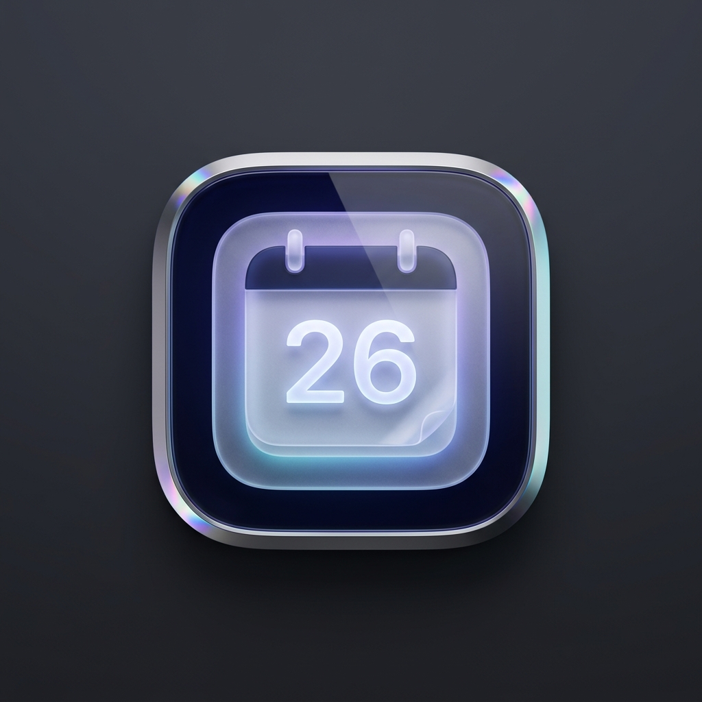

# Date 📅

<p align="center">
  
</p>

<p align="center">
  <strong>基于 macOS 26 设计美学的 Windows 11 任务栏日期与星期显示极简工具</strong>
</p>

<p align="center">
  <a href="https://github.com/Crucialmer/Date/releases"></a>
  <a href="https://dotnet.microsoft.com/"></a>
  <a href="LICENSE"></a>
  <a href="#"></a>
</p>

---

## 🌟 特性亮点

- **🍎 macOS 26 极简玻璃美学**：
  - 采用流体药丸胶囊轮廓与毛玻璃拟态（Vibrancy Frosted Glass）。
  - 超精细高光微边框，微型独立星期徽章，呈现纯正 Apple 级现代视觉质感。
- **📌 任务栏原生级吸附**：
  - 自动挂载于 Windows 11 系统托盘左侧。
  - 动态跟踪托盘图标变化、屏幕分辨率调整、多显示器切换与系统 DPI 缩放。
- **🌓 深浅色无感自适应**：
  - 实时监听 Windows 11 系统主题变化，智能切换 Obsidian 深色玻璃与 Crystal 浅色高透玻璃。
  - 同时支持在托盘菜单中强制锁定「深色」或「浅色」。
- **🍃 纯正绿色便携软件**：
  - 运行时产生的全部数据（`config.json` 等）严格保存在程序所在文件夹，绝不向 `%AppData%`、`%LocalAppData%` 或系统注册表写入任何残留。
- **🔄 GitHub 检查更新机制**：
  - 支持启动时静默检查更新与托盘菜单一键手动检测，直连 GitHub Releases。
- **🧘‍♂️ 纯粹克制，零打扰**：
  - 专注日期与星期展示，不弹出任何多余内容，点击不争夺焦点（`WS_EX_NOACTIVATE`），不占用 Alt+Tab 任务切换窗口。

---

## 🖼️ 预览与图标设计

| macOS 26 应用图标 | 托盘状态栏图标 |
|:---:|:---:|
|  |  |
| 液态流光连续曲率 Squircle | 高对比度像素对齐微型日历 |

---

## ⚙️ 配置文件 (`config.json`)

程序首次运行后会在自身目录下自动生成 `config.json`，可根据个人偏好进行修改：

```json
{
  "DateFormat": "yyyy年M月d日",
  "DayOfWeekFormat": "dddd",
  "ThemeMode": "Auto",
  "OffsetLeft": 8,
  "CheckUpdatesOnStartup": true,
  "GitHubRepo": "Crucialmer/Date"
}
```

* **`DateFormat`**：日期格式（支持任意标准 .NET 日期格式化字符串，例如 `yyyy/MM/dd`、`M月d日`）。
* **`DayOfWeekFormat`**：星期格式（例如 `dddd` 为 `星期日`，`ddd` 为 `周日`）。
* **`ThemeMode`**：外观模式，可选 `"Auto"`（跟随系统）、`"Dark"`（深色）、`"Light"`（浅色）。
* **`OffsetLeft`**：与托盘区域左侧边缘的像素安全间距。

---

## 🛠️ 编译与打包

### 前置要求
- Windows 11 (22H2 / 23H2 / 24H2 或更高版本)
- [.NET 10.0 SDK](https://dotnet.microsoft.com/download/dotnet/10.0)

### 快速本地运行
```bash
git clone https://github.com/Crucialmer/Date.git
cd Date
dotnet run
```

### 发布单文件便携绿色版
```bash
dotnet publish -c Release -r win-x64 --self-contained false -p:PublishSingleFile=true -o ./publish
```
编译产物即在 `./publish/Date.exe`，直接双击即可运行。

---

## 📄 开源许可证

本项目基于 [MIT License](LICENSE) 开源。
